# Instructor Key — Exercise 8: Plates, Peak Shape and the Sample's Own Conductivity

**Every value below was measured against drylab v0.24.7** with the app's
own readout logic (`validation/ex8/harness.py` reproduces the CE cell:
plug at 0.2 L with a 1/e half-width of 0.8 mm, `detector_trace`, FWHM
from the saved times, apparent mobility from plug center to detector
node). `validation/ex8/measure_ex8.py` regenerates
`validation/ex8/key_values.json` in four sections of under a minute
each. Section: **CE**. Grid points **257** throughout, as the sheet
instructs. No CSV export exists in the CE section; every number is on
screen.

**Hand values versus the app.** Plate counts below are computed the way
students compute them, from the *displayed* (rounded) migration time and
FWHM. FWHM is quantized to the saved time step (0.039 s at 500 V and
257 points), so expect about ±5 % scatter between groups.

**Known app defect students will meet (v0.24.7).** Time slice 0 carries
the solver's hydronium *starting guess*, not the equilibrium, so pH and
conductivity at slice 0 read wrong (pH 7.00 and 0.113 S/m in the Tris
BGE, against the true 4.93 and 0.0836 S/m). Every slice from 1
(t ≈ 0.03 s) onward is correct, and the run itself is unaffected. The
sheet sends students to slice 1. Logged in `.context/memory/issues.md`
with the one-line fix.

**Timing.** Ten runs in class, 8 to 15 s each at 257 points.

---

## Getting started

Tris BGE, samples at 0.1 mM, 500 V, 20 s, detector 15 mm, EOF 0.

| Quantity | App shows |
|---|---|
| Field E | 16667 V/m |
| Current density j | 1394.1 A/m² |
| Joule heating | 0.05 W/m (radial dT 0.01 K) |
| Background pH | 4.93 |

| Analyte | t (s) | FWHM (s) | N (hand) |
|---|---|---|---|
| potassium K+ | 7.22 | 1.13 | 226 |
| sodium Na+ | 10.52 | 1.59 | 243 |
| lithium Li+ | 13.59 | 2.02 | 251 |

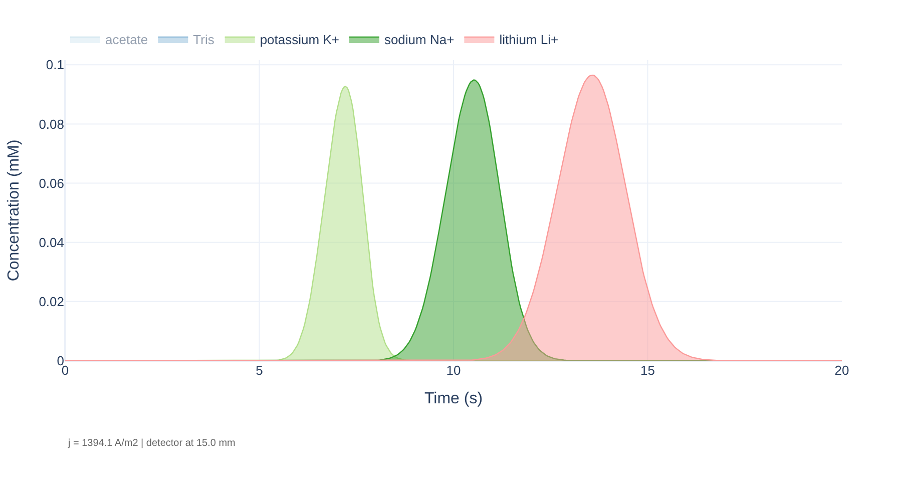 Figure 1. Electropherogram students should see at the start (Tris BGE, 0.1 mM samples, 500 V, detector 15 mm). Three symmetric peaks. BGE traces are greyed out in the legend because the app hides them.

## Q1 — Conductivity from the current

$$\kappa = \frac{j}{E} = \frac{1394.1\ \mathrm{A\,m^{-2}}}{16667\ \mathrm{V\,m^{-1}}} = 0.0836\ \mathrm{S\,m^{-1}}$$

The overlay at slice 1 reads **0.0836 S/m** away from the plug (0.0864
S/m at the plug center, where the 0.1 mM sample cations add a little).
They agree because the app sets j once from the BGE conductivity and the
field, j = κE. **The point to land:** the voltage is the control, and
the current is a property of the buffer. A group that reads 0.113 S/m
has read slice 0 (see the defect note).

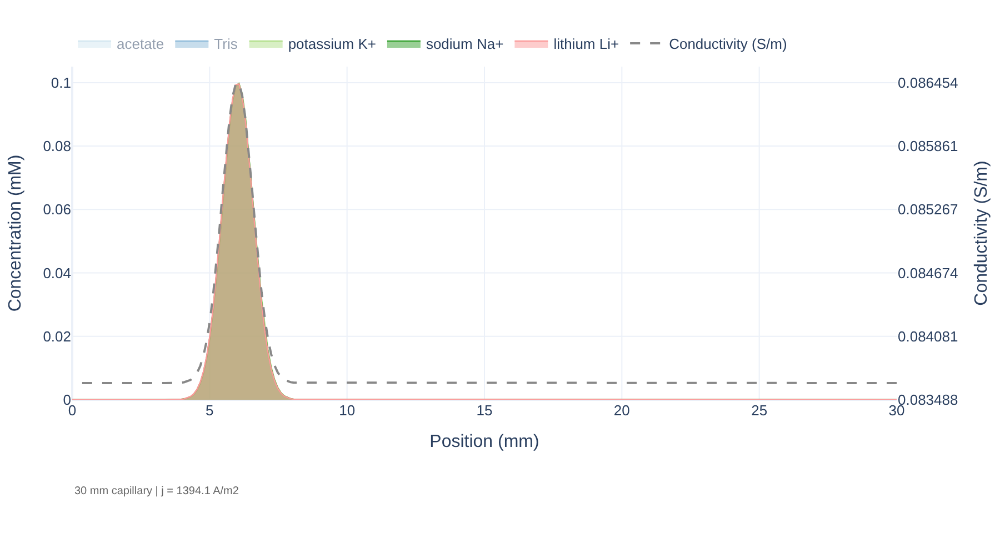 Figure 2. Spatial profile at time slice 1 with the conductivity overlay (dashed, right axis). The BGE reads 0.0836 S/m. The plug at 6 mm reads slightly higher. Plotly auto-scales the right axis to the tiny 3 % bump, so its tick labels look odd; students should read the flat baseline.

---

## Q2 — Diffusion-only prediction

$$N = \frac{zV\ell}{2(k_BT/e)L} = \frac{(1)(500)(9)}{2(0.02569)(30)} = 2920 \qquad N_{1500} = 8760$$

Ratio **3**: N should grow in proportion to V.

## Q3 — Measured

| Voltage (V) | t K⁺ (s) | FWHM K⁺ (s) | N K⁺ | Joule (W/m) |
|---|---|---|---|---|
| 500 | 7.22 | 1.13 | 226 | 0.05 |
| 1000 | 3.61 | 0.54 | 248 | 0.18 |
| 1500 | 2.41 | 0.35 | 263 | 0.41 |

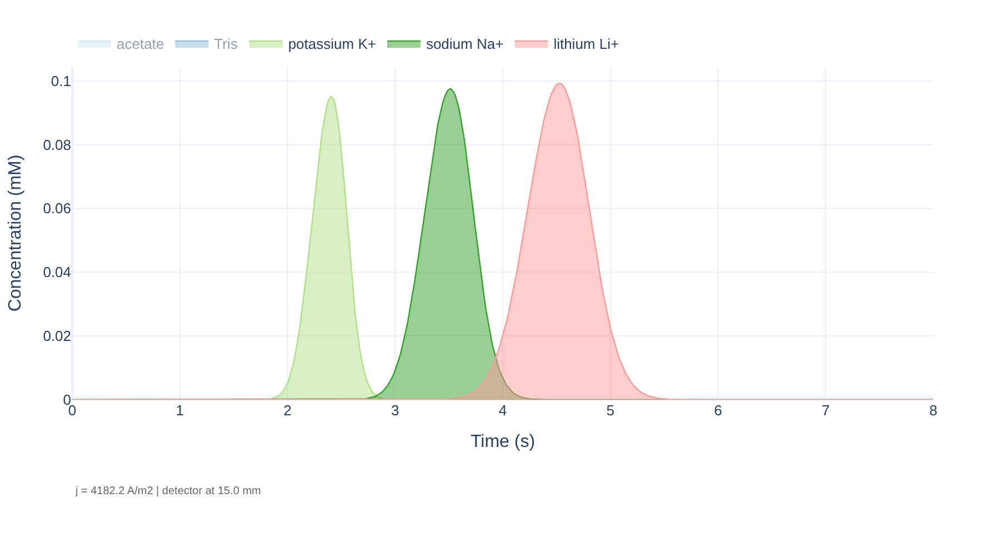 Figure 3. 1000 V (left, 12 s run) and 1500 V (right, 8 s run). Peaks arrive sooner and look narrower in seconds, but N barely moves. Note j in the stamp doubles and triples with the voltage (2788.1 and 4182.2 A/m²): the current follows the field.

N rises only **16 %** for a threefold voltage, and is about 1/13 of the
diffusion-only prediction at 500 V.

## Q4 — Reconcile: the injection dominates

$$D = \mu_{ep}\frac{k_BT}{e} = (76.2\times10^{-9})(0.02569) = 1.96\times10^{-9}\ \mathrm{m^2\,s^{-1}}$$

$$\sigma_{diff}^2 = 2Dt = 2(1.96\times10^{-9})(7.22) = 2.83\times10^{-8}\ \mathrm{m^2} = 0.0283\ \mathrm{mm^2}$$

$$\sigma_{inj}^2 = (0.57)^2 = 0.325\ \mathrm{mm^2}$$

The injection variance is **11.5 times** the diffusion variance.

$$N = \frac{\ell^2}{\sigma_{inj}^2+\sigma_{diff}^2} = \frac{81}{0.325+0.0283} = 229$$

Measured 226. **Why voltage barely helps:** raising V shortens t and
shrinks σ_diff², but σ_inj² does not depend on V and already makes up
92 % of the total. The small rise from 226 to 263 is the diffusion term
shrinking toward zero. The limit is ℓ²/σ_inj² ≈ 250 (253 with the exact
plug σ of 0.566 mm), and 263 sits on it within the ±5 % FWHM-reading
scatter.

**Watch for** groups that blame Joule heating. The readout answers that:
0.41 W/m and a radial ΔT of 0.05 K at 1500 V. Heating would lower N as V
rises, and N went up.

---

## Q5 — Detector at 25 mm, predicted

ℓ = 25 − 6 = **19 mm**. Expected t ≈ 7.22 × 19/9 = 15.2 s, so

$$\sigma_{diff}^2 = 2(1.96\times10^{-9})(15.2) = 0.0596\ \mathrm{mm^2} \qquad N = \frac{361}{0.325+0.0596} = 939$$

FWHM in seconds: **about the same**. The injection width in time is
σ_inj / v, and v is unchanged at fixed V.

## Q6 — Measured

| Detector (mm) | t K⁺ (s) | FWHM K⁺ (s) | N K⁺ |
|---|---|---|---|
| 25 | 15.19 | 1.13 | 1001 |

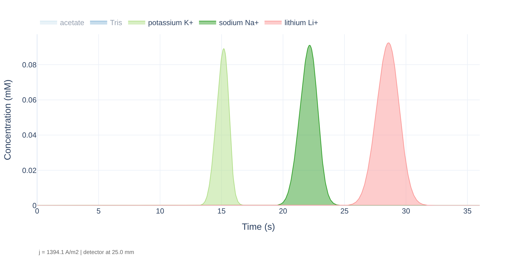 Figure 4. Detector at 25 mm (500 V, 36 s run). Same peak widths in seconds as Figure 1, but spread over a longer time axis: the peaks look sharper because N is 4.4 times larger.

N rose by **4.4 times** (226 → 1001), close to (19/9)² = 4.46. The width
in seconds did not change (1.13 s). **The lever when the injection
dominates is migration distance (or a shorter plug), not voltage.** The
zone keeps the same physical width while the distance it is measured
against grows.

---

## Part B baseline — imidazole co-ion, 0.1 mM

| Analyte | t (s) | FWHM (s) | Shape |
|---|---|---|---|
| K⁺ | 7.13 | 1.09 | symmetric |
| Na⁺ | 10.43 | 1.55 | symmetric |
| Li⁺ | 13.45 | 2.06 | symmetric |

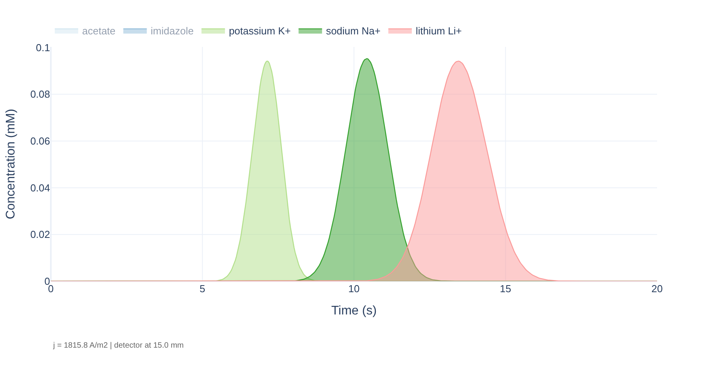 Figure 5. Imidazole co-ion, 0.1 mM samples. Indistinguishable from Figure 1 at this concentration.

pH stays 4.93. Imidazole (pKa 7.05) is fully protonated at this pH, so
12 mM imidazolium balances 12 mM acetate, exactly as Tris did.

## Q7 — Predictions

| Analyte | vs imidazolium (52.0) | Shape | t at maximum |
|---|---|---|---|
| K⁺ (76.2) | faster | diffuse front, sharp rear | later |
| Na⁺ (51.9) | matched | symmetric | about the same |
| Li⁺ (40.1) | slower | sharp front, diffuse rear | earlier |

## Q8 — Measured at 2 mM

| Analyte | t (s) | FWHM (s) | Height (mM) | Asymmetry at 10 % (rear/front) |
|---|---|---|---|---|
| K⁺ | 7.99 | 1.58 | 1.421 | 0.37 |
| Na⁺ | 10.78 | 1.77 | 1.705 | 1.00 |
| Li⁺ | 13.27 | 2.79 | 1.416 | 1.86 |

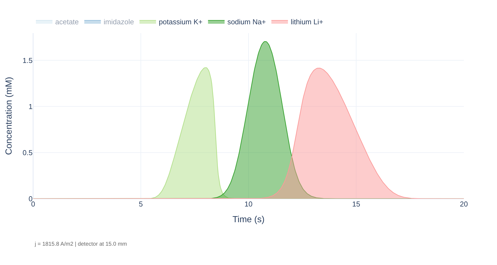 Figure 6. Imidazole co-ion, 2 mM samples. K⁺ (faster than the co-ion) has a slow rise and a sharp drop. Na⁺ (matched) stays symmetric. Li⁺ (slower) has a sharp rise and a long tail. Remind students that in a time trace the front of the zone arrives first, so a diffuse front is the slow rise on the left.

The asymmetry column is for the instructor: the app does not report it,
and students describe the shapes in words. K⁺'s maximum moved later
(7.13 → 7.99 s) and Li⁺'s moved earlier (13.45 → 13.27 s), as predicted.

## Q9 — Reconcile

K⁺ displaces imidazolium to keep the zone electroneutral. K⁺ is faster,
so the zone **conducts better**. The current density is the same
everywhere, so the field inside the zone is **lower** (E = j/κ). A K⁺ ion
that diffuses out ahead enters the higher field of the BGE and runs
further ahead, so the front spreads. One that falls behind also enters
the higher field and runs back into the zone, so the rear stays sharp.
Na⁺ has the same mobility as imidazolium, so replacing one with the
other leaves κ, and therefore the field, unchanged.

**Honest note for discussion:** Na⁺ still broadened slightly (1.55 →
1.77 s, N 251 → 205) while staying symmetric. All three ions start in one
plug, and during the first seconds the K⁺ and Li⁺ zones overlap the Na⁺
zone, changing its local field. Strong groups notice this. It is real
in the model and does not contradict the rule.

---

## Q10 — Salty sample, predicted

**Wider and shorter.** The salt raises the plug conductivity, so the
field in the plug is lower. K⁺ at the front of the plug crosses into the
BGE and speeds up, while K⁺ still inside lags, and the zone stretches as
it leaves.

## Q11 — Measured (30 mM NaCl)

| Quantity | Value |
|---|---|
| K⁺ t | 8.59 s |
| K⁺ FWHM | 4.26 s |
| K⁺ height | 0.027 mM |
| κ in the plug (slice 1) | 0.488 S/m |
| κ in the BGE (slice 1) | 0.109 S/m |

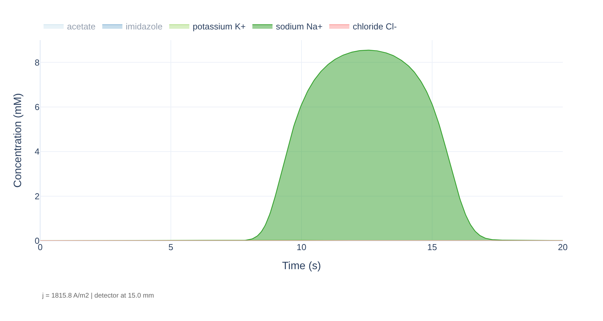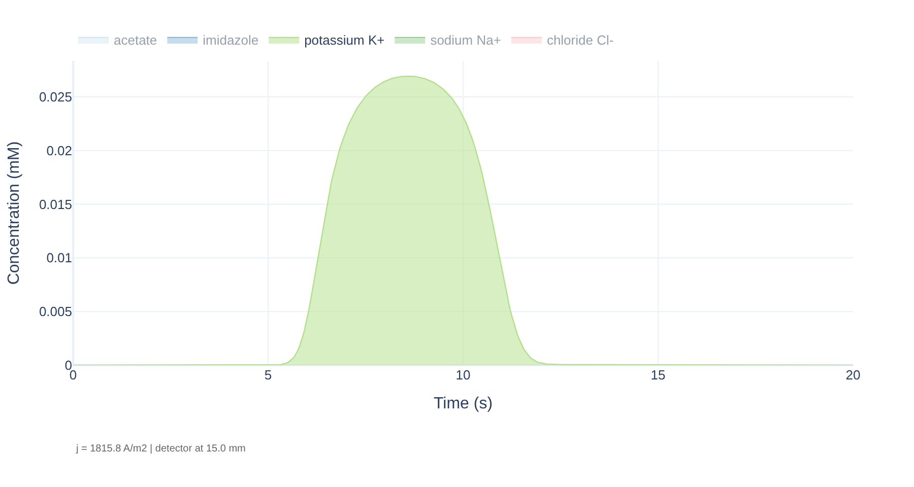 Figure 7. Salty sample as first drawn (left): the 30 mM sodium peak fills the axis and K⁺ is invisible. After clicking sodium Na+ and chloride Cl- off in the legend (right), the K⁺ zone appears flat-topped and about four times wider than in Figure 5. The faint chloride rise at the far right of the left panel is numerical residue at the 0.001 mM level.

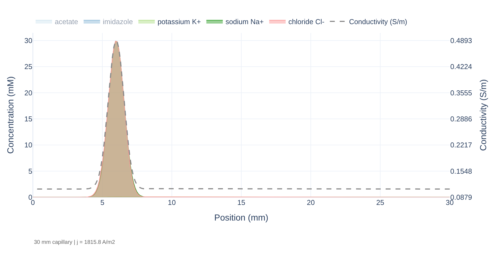 Figure 8. Spatial profile at time slice 1 with the conductivity overlay: 0.488 S/m at the plug center against 0.109 S/m in the BGE.

## Q12 — Reconcile

$$\frac{\mathrm{FWHM_{salty}}}{\mathrm{FWHM_{B}}} = \frac{4.26}{1.09} = 3.9 \qquad \frac{\kappa_{sample}}{\kappa_{BGE}} = \frac{0.488}{0.109} = 4.5$$

The zone stretched by close to the conductivity ratio, as
ℓ_zone ≈ ℓ_inj κ_sample/κ_BGE predicts. The equation treats the plug
boundary as fixed. In the run the salt zone itself migrates and spreads,
which is why the agreement is close but not exact. The effect is
**antistacking** (also called destacking). The peak height fell to 29 %
of the Part B value, and the migration time grew from 7.13 to 8.59 s
because K⁺ spent its first seconds in the low-field plug.

**On the warning:** it is related but not the same mechanism. Both come
from a local change in conductivity setting a local field. In Part B the
*analyte's own* ions changed κ and carried that change with them for the
whole run, so the peak became asymmetric. Here the *sample matrix* sets
the field during injection and loading, and the K⁺ peak stays nearly
symmetric (asymmetry 1.04) but wide. The warning is right that the
sodium zone itself is far too concentrated.

**Fixes:** dilute or desalt the sample, make it up in BGE or water, or
raise the BGE concentration so κ_BGE approaches κ_sample.

**Extension** (if a group finishes early, 10 mM NaCl): FWHM 2.12 s, a
ratio of 1.95 against a conductivity ratio of 0.236/0.109 = 2.17.

---

## Q13 — Class checkpoint

Any defensible choice. The strongest answers connect each effect to a
preparation step: plug length or injection time (Part A), sample
concentration relative to the co-ion and co-ion choice (Part B), and the
salt content of the sample (Part C).

---

## Homework

### H1 — N against ℓ²

| Detector (mm) | ℓ (mm) | Run time (s) | t K⁺ (s) | FWHM K⁺ (s) | N K⁺ |
|---|---|---|---|---|---|
| 10 | 4 | 20 | 3.18 | 1.09 | 47 |
| 15 | 9 | 20 | 7.22 | 1.13 | 226 |
| 20 | 14 | 30 | 11.26 | 1.13 | 550 |
| 25 | 19 | 36 | 15.19 | 1.13 | 1001 |

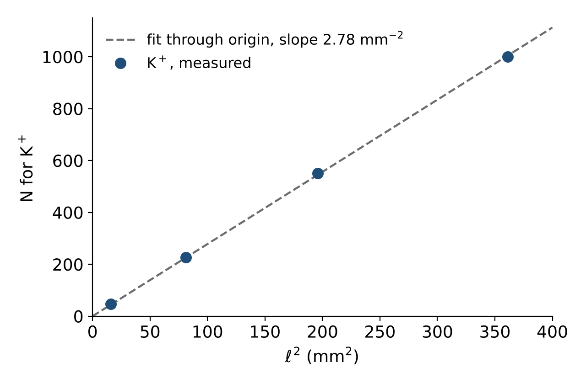 Figure 9. The plot students should produce for H1.

A least-squares line through the origin gives a slope of 2.78 mm⁻², so
σ = 1/√2.78 = **0.60 mm**, against the 0.57 mm stated. The slightly
larger value is the diffusion variance, which grows with ℓ and is folded
into the slope.

### H2 — pH selectivity for K⁺ and NH₄⁺

$$\alpha_{NH_4^+} = \frac{1}{1+10^{\,pH-pK_a}} \qquad \mu_{eff} = \alpha\,\mu_{ep}$$

| Chloride (mM) | App pH | α | μ_eff predicted | μ_app measured | Rs at 15 mm | Rs at 25 mm |
|---|---|---|---|---|---|---|
| 10 | 8.38 | 0.881 | 67.1 | 65.8 | 0.51 | 1.00 |
| 2 | 9.22 | 0.517 | 39.4 | 36.9 | 2.68 | 4.91 |

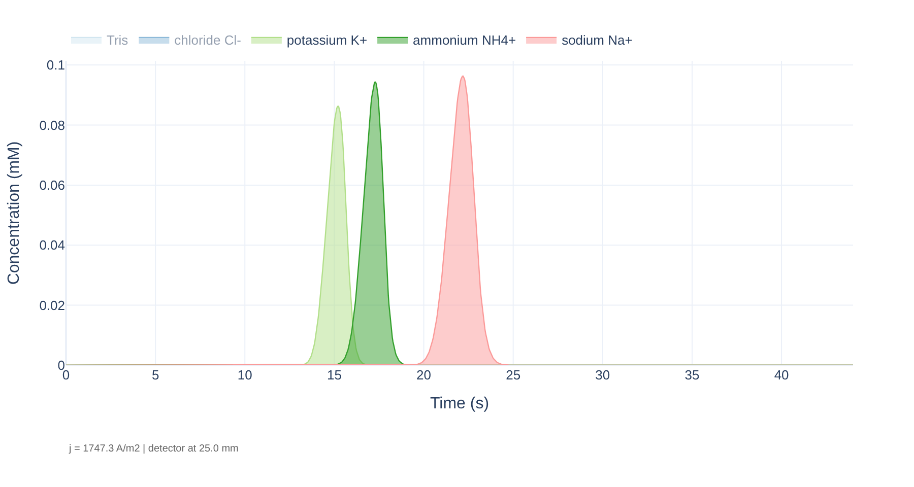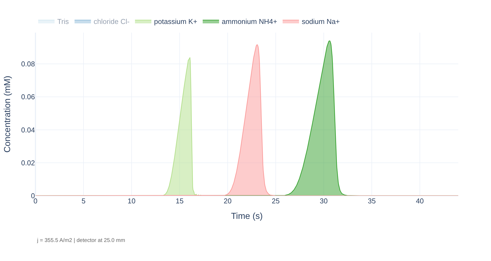 Figure 10. K⁺/NH₄⁺ at detector 25 mm: pH 8.38 (left, 10 mM chloride) and pH 9.22 (right, 2 mM chloride). At pH 9.22 NH₄⁺ migrates behind the Na⁺ marker, and all three peaks front because the co-ion (TrisH⁺, about 2 mM) is dilute.

Measured times (K⁺, NH₄⁺): 10 mM chloride, 15 mm: 7.25 / 8.25 s, FWHM
1.15 / 1.18 s. At 25 mm: 15.21 / 17.28 s, FWHM 1.22 / 1.22 s. 2 mM
chloride, 15 mm: 7.67 / 14.73 s, FWHM 1.20 / 1.91 s. At 25 mm: 16.04 /
30.60 s, FWHM 1.31 / 2.19 s.

**Point to land:** the two mobilities are equal, so all the selectivity
comes from the fraction of NH₄⁺ that is charged, and pH sets it. Moving
the detector also doubles Rs at pH 8.38, which ties back to Part A.

**K⁺ shape at 2 mM chloride:** the K⁺ peak fronts strongly (asymmetry
0.40 at 15 mm, 0.14 at 25 mm), even though K⁺ is only 0.1 mM. Only about
2 mM of Tris is protonated (it balances 2 mM chloride), so the co-ion is
dilute, and 0.1 mM K⁺ is 5 % of it. K⁺ is faster than TrisH⁺, so the
zone fronts. This is Part B's electromigration dispersion returning
because the BGE became dilute, not because the sample became
concentrated.

### H3 — Joule heating

0.41 W/m at 1500 V (500 V/cm) in the app's fixed 50 µm bore, radial ΔT
0.05 K. That is well under 1 W/m, so heating had no visible effect.

$$\frac{P}{L} = \kappa E^2 \pi r^2$$

Doubling the field quadruples P/L, doubling the bore radius quadruples
it, and doubling κ doubles it. Accept any two with the correct
exponent. The app's bore is fixed, so the field and the BGE
concentration are the two a student can actually change.
